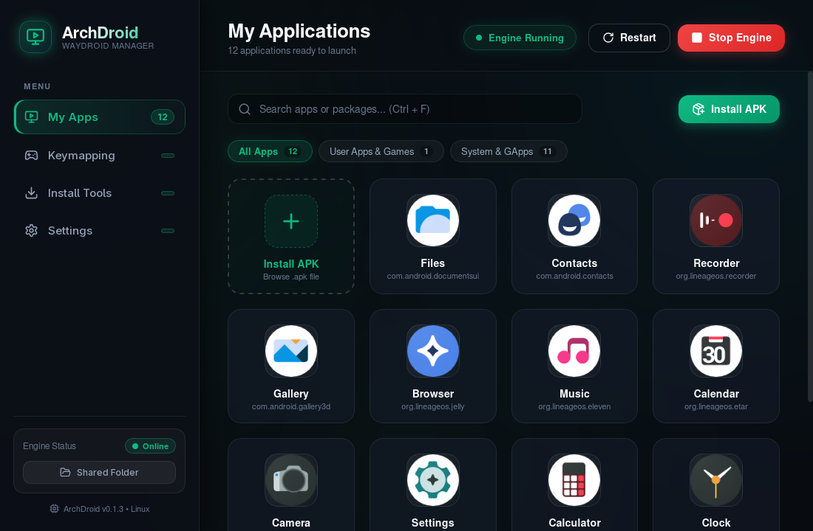
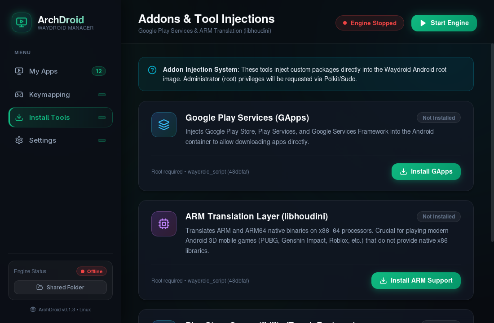
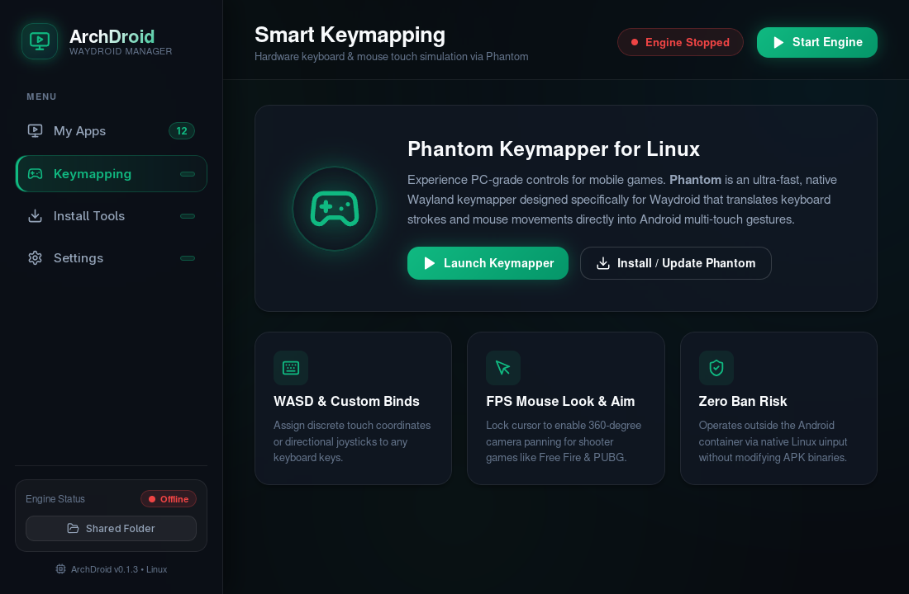
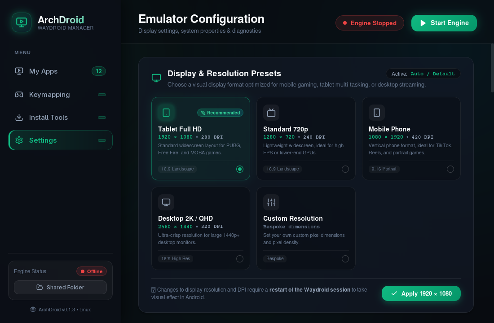
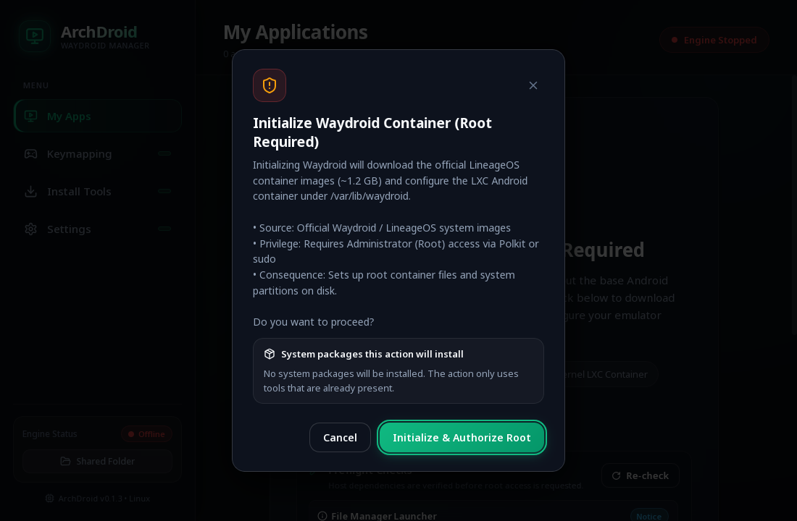

# ArchDroid

**Run Android apps and games on Linux, without the terminal.**

ArchDroid is a desktop app for [Waydroid](https://waydroid.net/). Set up Android, install APKs by drag-and-drop, add Google Play and ARM game support, map your keyboard and mouse to touch controls, and fix host problems from one window. Built with Tauri v2 + React 18.

[](https://github.com/wisangdg/archdroid/releases/latest)
[](https://github.com/wisangdg/archdroid/actions/workflows/ci.yml)
[](LICENSE)



---

## Highlights

- 🎮 **App library and launcher.** Your installed Android apps with icons, instant search (`Ctrl+F`), All/User/System filters, and a right-click menu.
- 📦 **Drag-and-drop APK install.** Drop an `.apk` from your file manager onto the window, or use the file picker.
- 🧩 **Google Play and ARM translation.** Add Google Play Services (MindTheGapps / OpenGApps) and Intel libhoudini so ARM-only games run on x86_64 CPUs.
- ⌨️ **Keyboard and mouse controls.** Build and launch the [Phantom](https://github.com/oliviermugishak/phantom) keymapper from the app: WASD, custom binds, and mouse look for shooters.
- 🖥️ **Display presets.** Tablet Full HD, Standard 720p, Mobile Phone (portrait), Desktop 2K / QHD, or your own resolution and DPI.
- 🩺 **Host diagnostics.** 17 checks (binder, GPU, Wayland, KVM, polkit, disk, network, and more), each with the command that fixes it.
- 🔒 **Root only when it's needed, and only after you agree.** Every root action shows you the exact command and packages first.

| Add-ons | Keymapping | Display presets |
|---|---|---|
|  |  |  |

---

## Quick Start

1. **Download** the package for your distro from the [latest release](https://github.com/wisangdg/archdroid/releases/latest). Optionally [verify the signature](docs/VERIFY-RELEASE.md) first.
2. **Install it:**

   | Distro | Command |
   |---|---|
   | Arch Linux and derivatives | `sudo pacman -U archdroid-bin-*.pkg.tar.zst` |
   | Ubuntu 24.04 / Debian (preview) | Add the [official Waydroid repo](https://docs.waydro.id/usage/install-on-desktops) first (Ubuntu 24.04 does not ship `waydroid`), then `sudo apt install ./ArchDroid_*_amd64.deb` |
   | Any x86_64 distro | `chmod +x ArchDroid_*.AppImage && ./ArchDroid_*.AppImage` |

3. **Open ArchDroid** and click **Initialize Android Emulator**. ArchDroid checks your system first, then downloads the Android image (about 1.2 GB) after you approve the root prompt.
4. Click **Start Engine**. Your apps show up in **My Apps**.

You need a Wayland desktop session (GNOME, KDE Plasma, Hyprland, Sway, ...) and a kernel with binder support. See [Requirements](#requirements).

---

## Supported Distributions

ArchDroid detects your package manager and installs the right dependency packages for it.

| Distribution | Package | Status |
|---|---|---|
| **Arch Linux, CachyOS, EndeavourOS, Manjaro** | `.pkg.tar.zst` (release), local PKGBUILD, AppImage | **Tier 1 (Fully Supported & Live-Tested)**<br>Live-tested in an Arch Linux QEMU/KVM VM, including Phantom and drag-and-drop on Wayland and X11. See [docs/P0-8.2-MATRIX-RESULTS.md](docs/P0-8.2-MATRIX-RESULTS.md) and [docs/P0-9.1-PACKAGING-RESULTS.md](docs/P0-9.1-PACKAGING-RESULTS.md). |
| **Ubuntu, Debian, Linux Mint, Pop!_OS** | `.deb` (release), AppImage | **Tier 2 (Best-Effort)**<br>`.deb` live-tested in an Ubuntu 24.04 LTS VM: install, Waydroid installed by the app through `apt` (after adding the official Waydroid repo), init via polkit, engine start/stop, APK drag-and-drop, CSP. Debian, Mint, and Pop!_OS are untested. |
| **Fedora, RHEL, Alma, Rocky Linux** | `.rpm` (build from source), AppImage | **Tier 2 (Best-Effort)**<br>`.rpm` live-tested in a Fedora 44 VM: `dnf install` (pulls `waydroid` from the Fedora repos), init via polkit, engine start/stop, app list, APK drag-and-drop, CSP, `dnf remove arch-droid`. RHEL/Alma/Rocky are untested. |
| **openSUSE Tumbleweed / Leap** | `.rpm` (build from source), AppImage | **Tier 2 (Best-Effort)**<br>Package mapping is covered by backend unit tests (`platform.rs`); no live VM run yet. |

**Not supported:**

- **Pure X11 sessions.** Waydroid needs a Wayland compositor. On X11, run a nested compositor such as `weston` or `cage`.
- **Automatic dependency install on Alpine, Void, NixOS, Guix.** ArchDroid stops before asking for root; install `waydroid`, `squashfs-tools`, and `lzip` from your distro repos yourself.
- **Windows and macOS.** Waydroid depends on Linux kernel namespaces, cgroups, and binder.

---

## Requirements

1. **Linux kernel** 5.x or newer with `binder` (or `binderfs`). Stock kernels on modern Arch, Ubuntu, Fedora, and openSUSE include it.
2. **GPU render node** `/dev/dri/renderD128` with Mesa/Vulkan drivers.
3. **Wayland session** (`WAYLAND_DISPLAY` set).
4. **A polkit agent** in your desktop session (`hyprpolkitagent`, `polkit-gnome`, `polkit-kde-agent`, ...), or run ArchDroid from a terminal to use `sudo`.
5. **About 1.5 GB of free disk space** for the Android image.

You don't have to check these by hand: the Setup screen and **Settings → Host Diagnostics** run the checks and show the fix for anything missing.

---

## Installation Details

### Arch Linux (Tier 1)

**Release package (recommended).** Download `archdroid-bin-<version>-x86_64.pkg.tar.zst`, verify it, and install:
```bash
sudo pacman -U archdroid-bin-*.pkg.tar.zst
```

**Build from source.** The PKGBUILD packages a local build, so build the app first:
```bash
git clone https://github.com/wisangdg/archdroid.git
cd archdroid
npm ci
npm run tauri build
cd packaging/arch
makepkg -si
```

### AppImage (any x86_64 distro)

```bash
chmod +x ArchDroid_*.AppImage
./ArchDroid_*.AppImage
```
> [!TIP]
> ArchDroid clears the AppImage's own `PYTHONHOME` and `PYTHONPATH` when it calls host tools such as `/usr/bin/waydroid`, so the host's Python modules keep working.

### Debian / Ubuntu (Tier 2 preview)

Ubuntu 24.04 has no `waydroid` package in its official repos. Add the [official Waydroid repo](https://docs.waydro.id/usage/install-on-desktops) first, then:
```bash
sudo apt install ./ArchDroid_*_amd64.deb
```

### Fedora / openSUSE (Tier 2 preview)

The `.rpm` is not attached to releases yet. Build it from source (`npm ci && npm run tauri build`; the package lands in `src-tauri/target/release/bundle/rpm/`), then:
```bash
sudo dnf install ./ArchDroid-*.x86_64.rpm
```

### Verifying downloads

Each release ships a `SHA256SUMS` file covering the `.pkg.tar.zst`, `.AppImage`, and `.deb`, signed as `SHA256SUMS.asc` with the release key `18F47067ACC5BBF9`. Steps: [docs/VERIFY-RELEASE.md](docs/VERIFY-RELEASE.md). ArchDroid has no auto-updater; to update, install the new release the same way. Details: [docs/RELEASE-AND-UPDATES.md](docs/RELEASE-AND-UPDATES.md).

---

## First Run

1. **Status check.** ArchDroid checks whether Waydroid is installed and whether an Android image exists in `/var/lib/waydroid`.
2. **Setup screen.** Without an image, ArchDroid shows the **Preflight Checks** list (binder, GPU, Wayland, disk, network, polkit/sudo, ...). Blocking problems keep the **Initialize Android Emulator** button disabled until you fix them; click **Re-check** after fixing.
3. **Initialize.** ArchDroid explains what will happen and which packages (if any) will be installed. After you approve, it installs missing dependencies such as `waydroid`, runs `waydroid init` to download the official LineageOS-based image, and shows each step with a live log.
4. **Start Engine.** The Waydroid session starts and **My Apps** fills with the built-in Android apps. Add Google Play or ARM translation later from **Install Tools**.

---

## Privacy and Root Access

ArchDroid follows the **least-privilege** principle.

**Root is requested only for:**
1. Installing missing system packages (`waydroid`, `squashfs-tools`, `lzip`, `git`) with your package manager.
2. First-time initialization (`waydroid init`).
3. Add-on injection (GApps, libhoudini, multitouch), which modifies the Waydroid system image.

**Everything else runs as your normal user:** opening the app, starting the Waydroid session, launching apps, installing APKs, changing resolution and DPI, running Phantom, and diagnostics.



**Before every root prompt**, ArchDroid shows a consent dialog with:
- the exact command that will run;
- the distro packages that will be installed.

The Rust backend then re-checks that the packages match what you approved and rejects anything else. Root scripts run in a private temporary directory (mode `0700`) with their own cache, so they never write into your home directory.

ArchDroid collects no telemetry and uploads nothing on its own. What it stores and what network connections it makes are listed in [PRIVACY.md](PRIVACY.md).

<br clear="right">

### Security measures

- **Hash-pinned Python dependencies.** The add-on helper's Python packages are locked and verified by SHA-256 (`--require-hashes --only-binary=:all:`).
- **Pinned upstream code.** `waydroid_script` and Phantom are pinned to specific commits.
- **Isolated root environment.** Privileged scripts run in `mktemp -d` (mode `0700`), with `SUDO_USER` unset and the cache in `$ARCHDROID_WORK/cache`.
- **Package approval.** The backend refuses packages outside the approved plan (`approval_required` / `invalid_input`).
- **Fail-fast preflight.** On unsupported distros with missing dependencies, the operation stops before root is requested.
- **Strict Content Security Policy** in the app window: no remote scripts and no `eval`.

---

## Troubleshooting

### The root password dialog never appears (Hyprland / Sway / i3)
- **Symptom:** Install or init hangs or times out with no password popup.
- **Cause:** Standalone window managers don't start a polkit agent by default.
- **Fix:** Start one with your session:
  ```bash
  # Hyprland
  systemctl --user enable --now hyprpolkitagent.service
  # Or start polkit-gnome / polkit-kde from autostart
  /usr/lib/polkit-gnome/polkit-gnome-authentication-agent-1 &
  ```
  Or launch `archdroid` from a terminal to get a text `sudo` prompt.

### `binder: missing`
- **Symptom:** Diagnostics show Binder missing; Waydroid can't start the container.
- **Cause:** The kernel doesn't enable `binder_linux` or binderfs.
- **Fix:**
  - On Arch Linux, use the stock `linux` or `linux-zen` kernel.
  - On a custom kernel, enable:
    ```ini
    CONFIG_ANDROID_BINDER_IPC=y
    CONFIG_ANDROID_BINDERFS=y
    ```
  - Make sure binderfs is mounted:
    ```bash
    sudo mkdir -p /dev/binderfs
    sudo mount -t binder binder /dev/binderfs
    ```

### `Wayland: not running`
- **Cause:** You're in a pure X11 session (`DISPLAY` set, `WAYLAND_DISPLAY` empty).
- **Fix:** Log into a Wayland session ("GNOME on Wayland", "Plasma (Wayland)", Hyprland, Sway), or run a nested compositor such as `weston` or `cage`.

### `/dev/kvm: permission denied`
```bash
sudo usermod -aG kvm $USER
```
Then log out and back in.

### GPU notes
- **Intel and AMD** work out of the box with Mesa (DRI3/Vulkan).
- **NVIDIA proprietary:** set `nvidia-drm.modeset=1` in your kernel parameters. If you see rendering glitches, configure Waydroid to use the software renderer (`Mesa llvmpipe`).

### "Start Failed" or "Session Slow to Start"
The message includes the reason Waydroid reported. For the full log, create a Diagnostic Bundle (below).

### Reporting a bug (Diagnostic Bundle)
Open **Settings → Diagnostic Bundle → Create Bundle**. ArchDroid writes one text file, `~/Downloads/archdroid-diagnostics-<time>.txt`, with system and Waydroid versions, host diagnostics, add-on status, and recent logs. Home paths and token/password values are masked. The logs can include Android package names and APK file names you've used, so read the file and remove anything you don't want to share before attaching it to an [issue](https://github.com/wisangdg/archdroid/issues). The file is created without root and never uploaded automatically.

---

## Uninstall

### 1. Remove the app
| Install method | Command |
|---|---|
| Arch Linux | `sudo pacman -R archdroid-bin` |
| Debian / Ubuntu | `sudo apt remove arch-droid` |
| Fedora | `sudo dnf remove arch-droid` |
| openSUSE | `sudo zypper remove arch-droid` |
| AppImage | Delete `ArchDroid_*.AppImage` and its `.desktop` file in `~/.local/share/applications/`, if any |

The `.deb`/`.rpm` package is named `arch-droid`, not `archdroid`.

### 2. Remove ArchDroid's settings, cache, and logs
```bash
rm -rf ~/.config/io.github.archdroid ~/.cache/archdroid ~/.local/share/io.github.wisangdg.archdroid
```

### 3. Remove Android and all its data (optional)
This deletes every app and file inside Android. Back up anything you need from Android's shared storage first.
```bash
waydroid session stop
sudo systemctl stop waydroid-container.service
sudo rm -rf /var/lib/waydroid
rm -rf ~/.local/share/waydroid
```

Full list of data locations: [docs/DATA-AND-UNINSTALL.md](docs/DATA-AND-UNINSTALL.md).

---

## Known Limitations

1. **One Android container per machine.** Waydroid uses a single global LXC container, so ArchDroid can't run several Android instances in parallel.
2. **Wayland required.** There is no built-in X11 display server.
3. **libhoudini depends on upstream.** It comes from an upstream Google Android TV image fetched by a pinned helper script. Games with kernel-level anti-cheat may not run in a container.
4. **Distro coverage.** Full (Tier 1) live-verified support covers the Arch Linux family. Tier 2 distros are in preview: the `.deb` is live-tested on Ubuntu 24.04 LTS and the `.rpm` on Fedora 44, while Debian, the RHEL family, and openSUSE are not live-tested yet.
5. **Test coverage.** All main flows are live-tested in VMs (Arch, plus Ubuntu 24.04 and Fedora 44 for the core flow; see [`docs/P0-8.2-MATRIX-RESULTS.md`](docs/P0-8.2-MATRIX-RESULTS.md)). Not yet tested: real hardware across GPUs and desktops (GNOME/KDE/Hyprland, Intel/AMD/NVIDIA). If something fails on your system, attach a Diagnostic Bundle to your report.
6. **Add-on archive integrity.** `waydroid_script` is pinned and its Python dependencies are SHA-256 verified, but the GApps/libhoudini archives it downloads are checked against the **MD5** hashes in that commit. That catches corrupted or swapped files, but it isn't strong cryptographic protection.
7. **Connectivity check.** The "online" check opens a TCP connection, sending no data, to `1.1.1.1:53` (then `8.8.8.8:53`). On networks that block public DNS, diagnostics can say "Offline" even though downloads still work. See [PRIVACY.md](PRIVACY.md).

---

## Development

```bash
npm install          # frontend dependencies
npm run tauri dev    # Vite dev server + Tauri
```

Tests:
```bash
npm test                                                                  # frontend unit + component tests
cargo test --manifest-path src-tauri/Cargo.toml                           # Rust backend
cargo test --manifest-path src-tauri/Cargo.toml --features dev-commands   # with dev-only commands
```

Production build:
```bash
npm run tauri build
```
Packages (`.deb`, `.rpm`, `.AppImage`) are written to `src-tauri/target/release/bundle/`. The live VM test harness is in [`scripts/test-vm/`](scripts/test-vm/).

---

## License & Credits

- **ArchDroid**: [MIT](LICENSE), Copyright (c) 2026 wisangdg.
- **Waydroid**: [waydroid.net](https://waydroid.net) (GPL-3.0).
- **waydroid_script**: [casualsnek/waydroid_script](https://github.com/casualsnek/waydroid_script) (GPL-3.0), pinned commit `48dbfaf`. Downloaded when you install an add-on; not bundled in ArchDroid.
- **Phantom Keymapper**: [oliviermugishak/phantom](https://github.com/oliviermugishak/phantom) (MIT), pinned commit `1a6b7ed`.
- Third-party details and license audit: [`docs/THIRD-PARTY.md`](docs/THIRD-PARTY.md).

> [!NOTE]
> **Trademark Disclaimer**: LDPlayer and NoxPlayer are trademarks or registered trademarks of their respective owners. ArchDroid's interface takes inspiration from such desktop Android emulators, and the names are used here only for comparison. ArchDroid is an independent project and is not affiliated with, sponsored by, or endorsed by those trademark holders.
